<p align="center">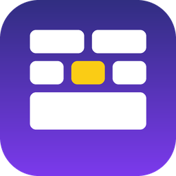</p>

# Form Canvas — drag-and-drop form designer for Mendix

Form Canvas is a pluggable widget that gives your Mendix app its own form designer. It draws the sections and fields
you keep in **your** entities at their real widths, and turns every gesture (add from the palette, move, resize,
select, open rules or access) into a call to **your** microflow or nanoflow. The widget stores nothing, evaluates
nothing and validates nothing: your app owns the data, the rules, the versions and the runtime form.

**[Try the demo app](https://aiwidgets-sandbox.mxapps.io/p/home)** (Form Canvas → Forms → Leave request) ·
[Download the widget](https://github.com/MohamedElNady/Form-Canvas/releases/latest) ·
[How to configure](HOW-TO-CONFIG.md) · [Getting started](docs/GETTING-STARTED.md) ·
[Build a form](docs/BUILD-A-FORM.md) · [How to test](HOW-TO-TEST.md) · [Changelog](CHANGELOG.md)

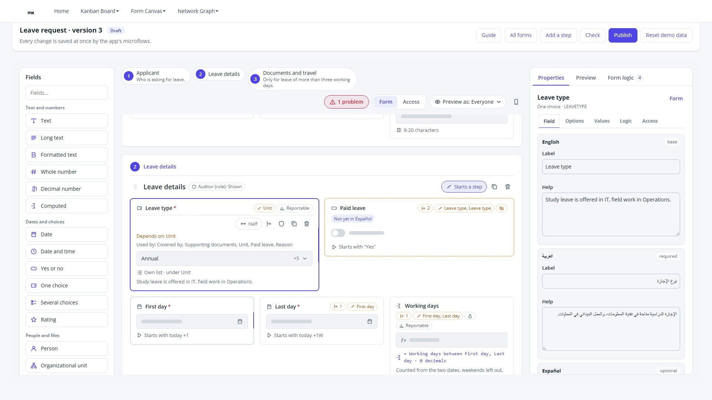

## Demo video

[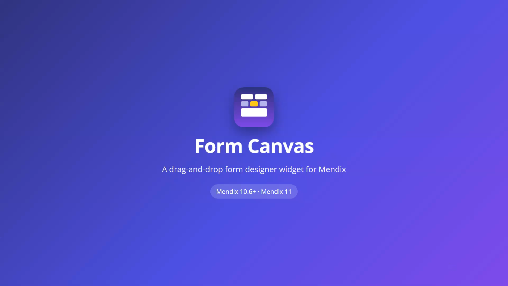](https://youtu.be/KOryy8OvIOY)

▶ **[Watch the demo on YouTube](https://youtu.be/KOryy8OvIOY)** (3:53, with voice-over and English captions;
[download](video/FormCanvas-1.0-demo.mp4) · [captions](video/captions_en.srt))

## Features

- **Real layout**: Full, Half and Third widths on a 6-track grid (two halves or three thirds per row), a phone-width
  toggle and automatic stacking below a width you choose; tables with their columns as a row strip or as cards.
- **Drag and drop**: palette to canvas, reorder, move across sections, into and out of tables, reorder sections, drop
  on a step chip; resize by pulling a field's edge or with the width chip.
- **Keyboard first**: Space picks up, arrow keys move (mirrored in right-to-left), Space drops, Escape cancels; Enter
  opens a field, Ctrl+←/→ resizes, D duplicates, R opens rules, A opens access, Delete deletes. Every move is announced
  with texts you can translate.
- **Rules, dependencies and access, as your app describes them**: rule chips in your own words ("Hidden when Leave
  type is Unpaid"), the selected field's sources and dependants highlighted, markers for shown-by-a-rule, required or
  read-only by a rule, and who may see or edit; a Form logic panel for rules on the whole form; an access matrix
  (stages or roles × sections and fields) and *Preview as*.
- **Choice options**: options from an enumeration, a lookup table or a fixed list drawn in the skeleton, with a chip
  saying where they come from.
- **Steps**: multi-step forms with a horizontal or vertical step bar, all steps on one page or one step at a time.
- **Versions**: a Read-only expression (for example a published version) turns the canvas into a viewer; problems
  per field and section, and change marks for comparing versions.
- **Docked side panel**: your own inspector, your own live preview and the form logic, beside the canvas.
- **Right to left, dark mode, any language**: logical CSS, automatic direction, `--fc-*` theme tokens with dark
  defaults, labels in a second language beside the first, every interface text a translatable text template
  (English and Arabic shipped).
- **Works from Mendix 10.6**: the widget writes a *drop context* into the data view object instead of using action
  variables, so it also works inside snippets.
- **Studio Pro**: grouped properties, consistency checks that name the attribute an action needs, structure and design
  mode previews, toolbox icon and tile (light and dark).

## Screenshots

All screenshots are of the demo app's **Leave request** form (Mendix 10.24.10, widget 1.0.0).

| | |
|---|---|
| 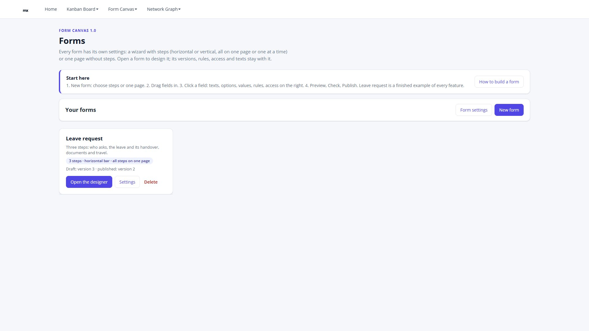 **Forms list**: every form with its own steps and versions | 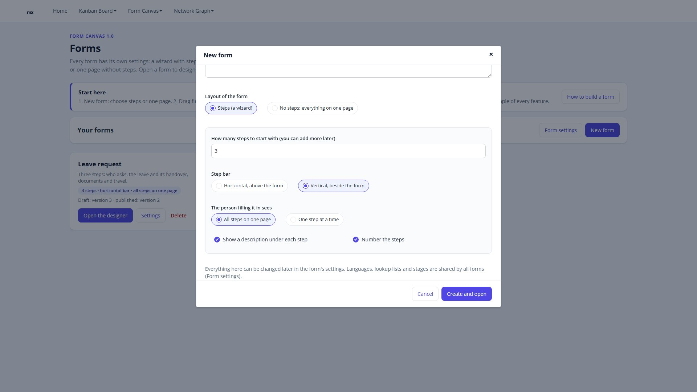 **New form**: steps or one page, horizontal or vertical step bar |
| 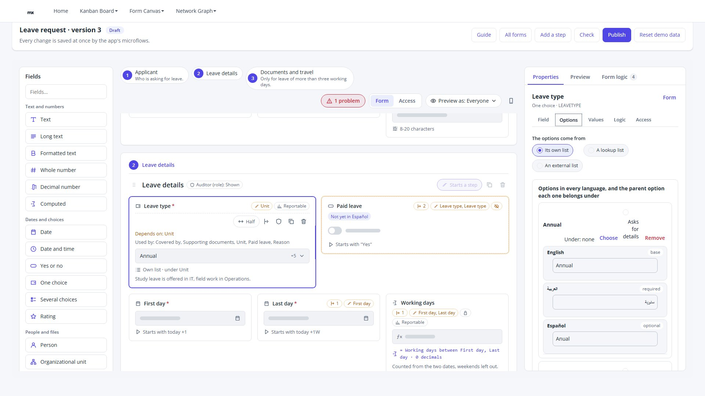 **Options**: its own list, a lookup list or an external list, per language, with parent options | 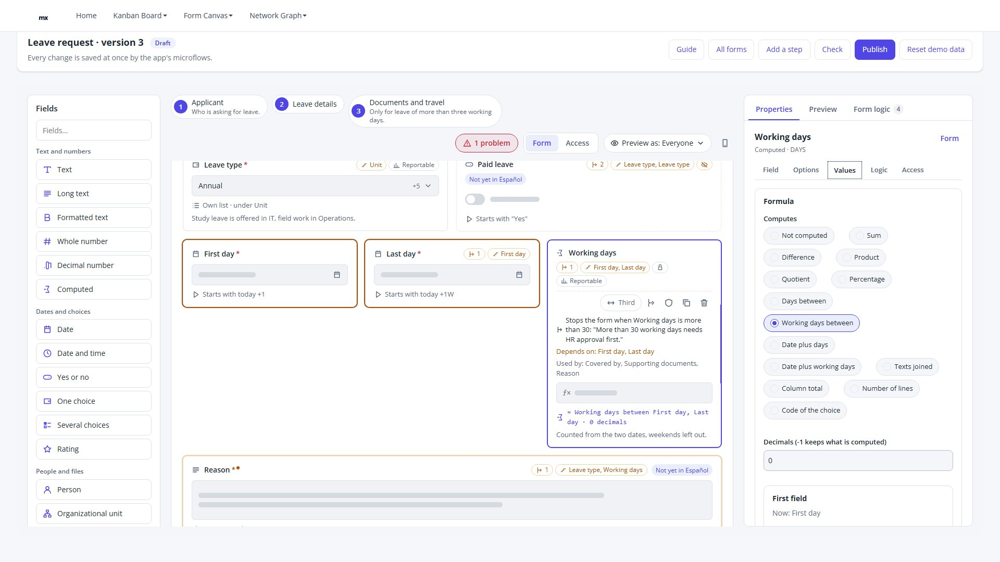 **Values**: computed fields, starting values and limits |
| 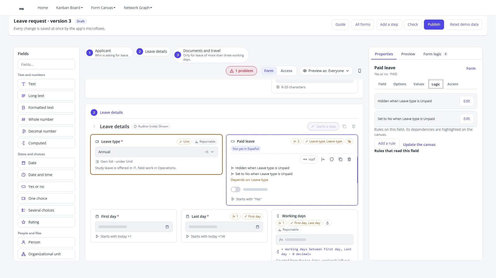 **Rules on a field**, with its dependencies highlighted on the canvas | 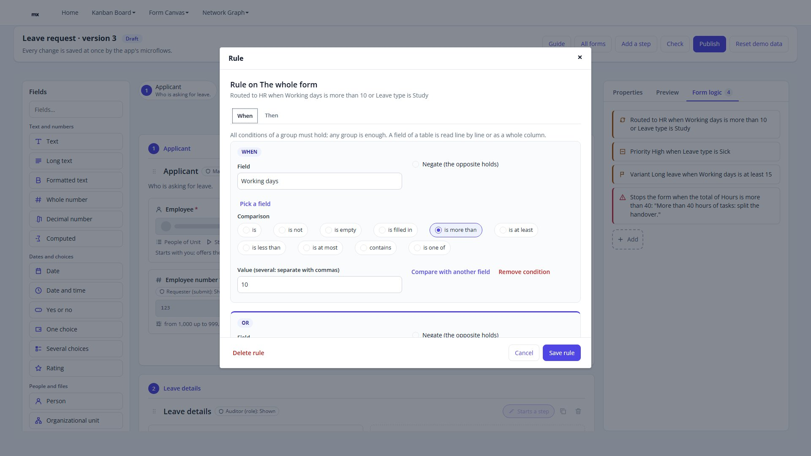 **Rule editor**: conditions in AND / OR groups |
| 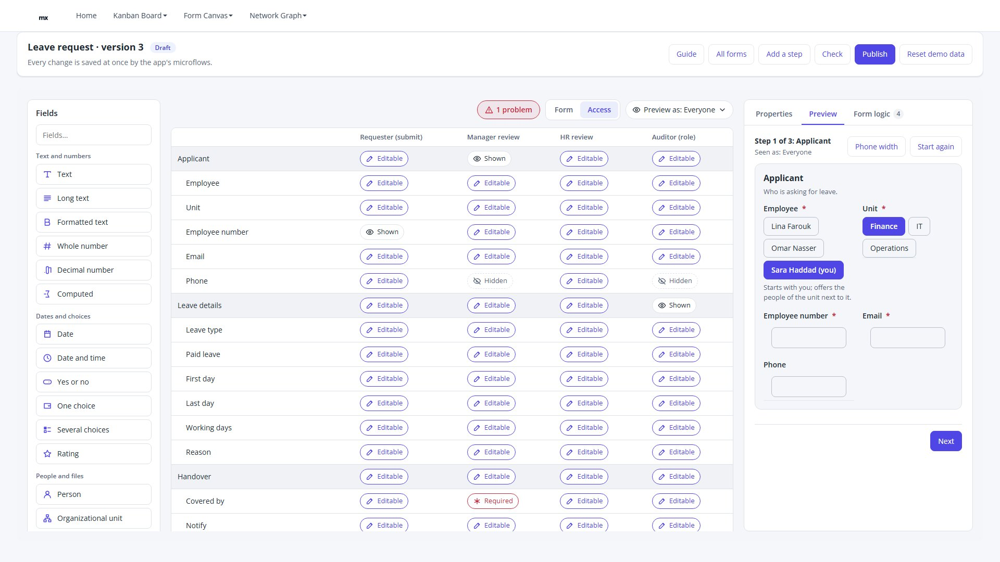 **Access matrix**: Hidden, Shown, Editable or Required per stage and role | 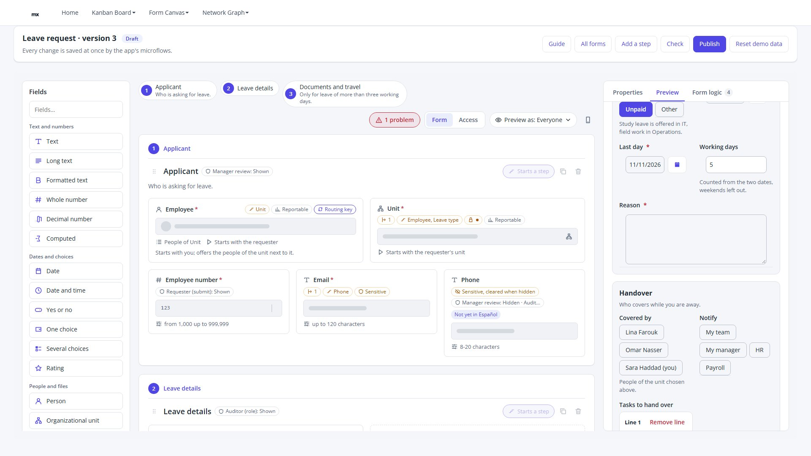 **Live preview** with the rules applied (Unpaid leave hides Paid leave) |
| 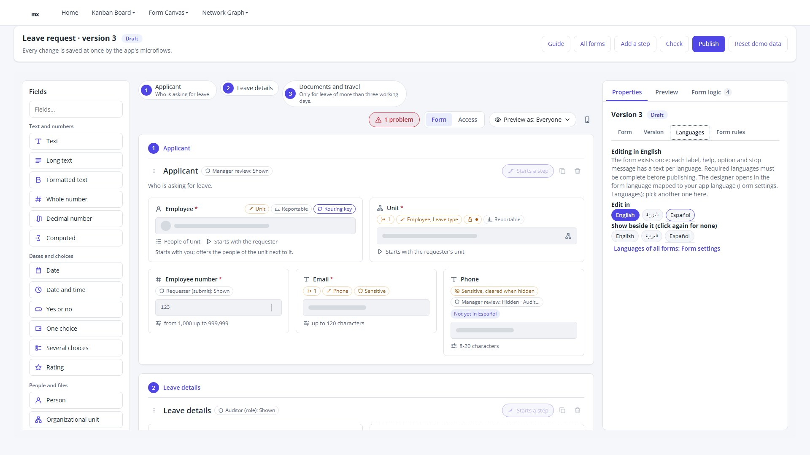 **Languages**: edit in one, show another beside it | 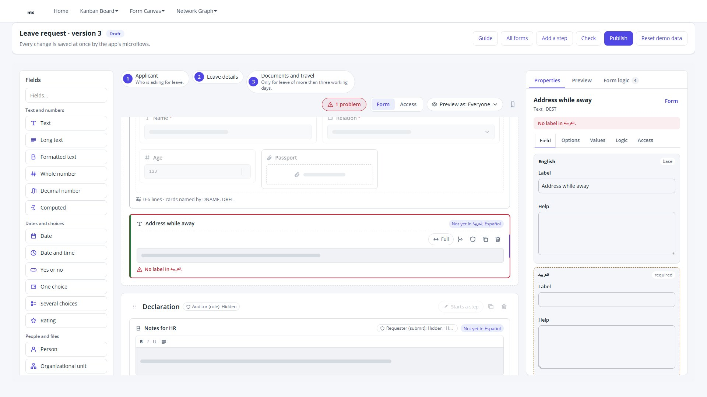 **Check**: each problem on its field, before Publish |
| 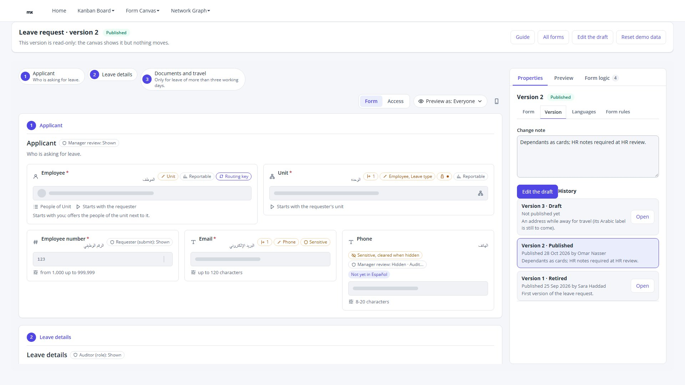 **A published version**, read-only, with the version history | 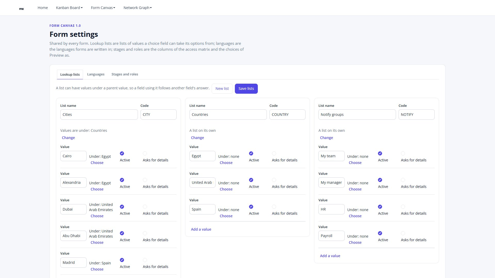 **Form settings**: lookup lists with parent values |
| 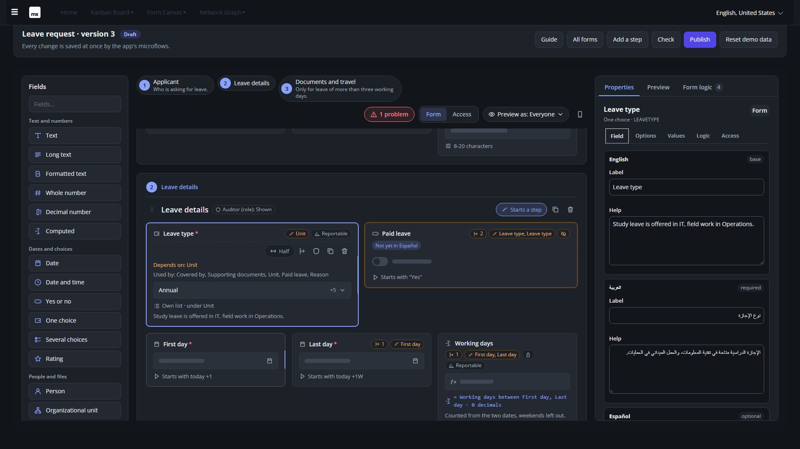 **Dark mode** | 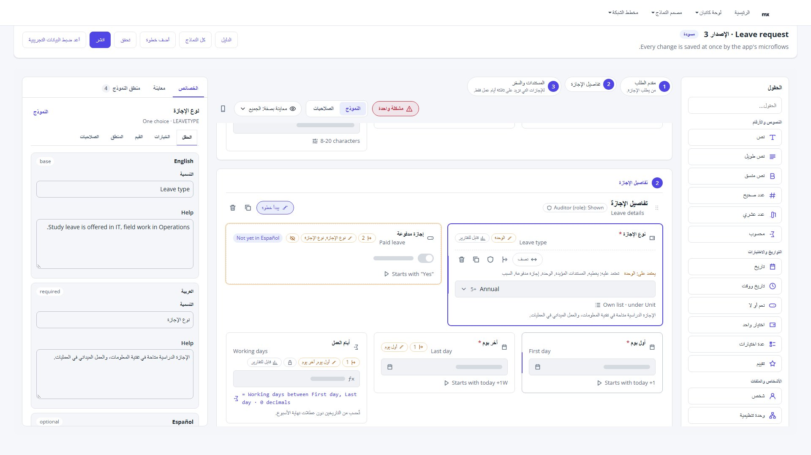 **Arabic, right to left** |

More in [docs/screenshots](docs/screenshots): form settings (languages, stages and roles), the landing page, dark and
Arabic versions of the access matrix and the preview.

## Mendix version compatibility

| Widget version | Mendix version | Tested on |
|---|---|---|
| 1.0.0 | 10.6.0 and later (10.x, 11.x) | 10.24.10 and 11.15.0 (full demo); 10.6.11 (smoke test: model check and the drop-context write) |

Form Canvas is a pluggable web widget (`supportedPlatform="Web"`). The demo module package (`FormCanvasDemo.mpk`) needs
Studio Pro 10.24.10 or later, because a module package imports only into the version it was made with or a newer one.

## Installation

### From the Mendix Marketplace
1. In Studio Pro, open the Marketplace and search for **Form Canvas**.
2. Download it into your app; the widget appears in the toolbox under **Data containers**.

### From GitHub
1. Download `elnady.FormCanvas.mpk` from the [latest release](https://github.com/MohamedElNady/Form-Canvas/releases/latest).
2. Copy it into your app's `widgets/` folder.
3. In Studio Pro: **App → Synchronize App Directory**.

### The demo module (optional)
`FormCanvasDemo.mpk` (a release asset) is the complete demo as a module, with the widget inside it: **File → Import
module package…**, then add `FormCanvasDemo.Forms_Web` to your navigation. Details in
[HOW-TO-TEST.md](HOW-TO-TEST.md#2-import-the-demo-module-into-your-app).

## Quick start

1. Create a non-persistent **designer context** entity, e.g. `FormDesignerContext` with
   `SectionKey` (String), `Position` (Integer), `TableKey` (String), `TypeKey` (String), `Width` (String or your width
   enumeration), `FieldKey` (String), `SelectedKey` (String).
2. On your designer page, add a **data view** of that object (a data source microflow that creates it) and drop
   **Form Canvas** in it.
3. **Sections tab**: Sections data source, Section key, Title, Order (and Starts a step for multi-step forms).
4. **Fields tab**: Fields data source, Field key, Section key (the key of its section, e.g.
   `$currentObject/MyModule.Field_Section/MyModule.Section/Key`), Label, Type key, Order, Width, Required.
5. **Palette tab**: list the field types users can add (or take them from a data source).
6. **Actions tab**: select the drop-context attributes, then the actions. A microflow for a field action takes the
   field **and** the context object: `ACT_Field_Move($Field, $Context)` reads `$Context/SectionKey`,
   `$Context/TableKey` and `$Context/Position`, moves the field and renumbers the others.

Studio Pro tells you which drop-context attribute an action is missing. [GETTING-STARTED.md](docs/GETTING-STARTED.md)
takes it from there one feature at a time; [HOW-TO-CONFIG.md](HOW-TO-CONFIG.md) lists every property, the microflow
patterns and a complete example.

## How it works in one picture

```
 your entities ──► Sections data source ─┐
                   Fields data source  ──┼─► Form Canvas ──► gesture ──► writes the drop context ──► calls your action
                   Palette (static/ds) ──┘      (draws)                 on the data view object        (microflow / nanoflow)
                                                                        section key, position,         creates, moves, resizes,
                                                                        table key, type key, width,    renumbers, commits,
                                                                        field key, selected key        refuses when it must
```

The canvas shows the change at once and keeps it until your data reloads (or 4 seconds pass), so a refused change
snaps back by itself.

## Guides

| Guide | For | What is in it |
|---|---|---|
| [GETTING-STARTED.md](docs/GETTING-STARTED.md) | Mendix developers | the smallest working designer in 15 minutes, then one feature group at a time |
| [HOW-TO-CONFIG.md](HOW-TO-CONFIG.md) | Mendix developers | every property, the drop-context attributes, microflow patterns, mapping an existing form model |
| [BUILD-A-FORM.md](docs/BUILD-A-FORM.md) | people who design forms | the demo designer step by step: fields, languages, options, rules, access, preview, publish |
| [HOW-TO-TEST.md](HOW-TO-TEST.md) | everyone | the online demo, importing the demo module, the MDL scripts, the manual test matrix, troubleshooting |

## The demo

The demo app (<https://aiwidgets-sandbox.mxapps.io/p/home>, menu **Form Canvas**) is a complete form designer built
around the widget: a forms list with New form, draft and published versions with Check and Publish, typed rules (show,
hide, require, optional, read-only, editable, set a value, stop with a message) on fields, sections and the whole form,
dependent choice lists, lookup lists with parent values, access per stage and role, three languages, a docked
inspector, a live preview that applies the rules, and shared Form settings. **Leave request** shows every feature;
**Reset demo data** brings it back.

It is also a module package, `FormCanvasDemo.mpk`, in this repository and on the
[release page](https://github.com/MohamedElNady/Form-Canvas/releases/latest).

### Placing it with mxcli (MDL) or testing it with scripts

- An expression property's value is itself a quoted string, so a string literal needs doubled inner quotes:
  `stepView: '''all''', stepLayout: '''horizontal''', stepDescriptions: 'true', stepNumbers: 'true'`.
  `stepView: 'all'` writes the expression `all`, not the string `'all'`.
- mxcli may write the per-item texts of an optional data source you left unset (Form logic, Access columns) as empty
  templates where Studio Pro stores none, which gives CE0463 *"The definition of this widget has changed"*. Set every
  data source you use, or run *Update widget* after an mxcli write (headless: `mxcli widget sync --widget
  elnady.formcanvas.FormCanvas`; `mx update-widgets` works too, but on an MPR v2 app it rewrites the app as one v1
  `.mpr` file).
- A drag needs a short travel before it starts, so a single instant pointer move from a test script does not drag.
  Drive the keyboard drag (Space, arrow keys, Space) or a pointer sequence with a few steps.
- Next to an app's own navigation rail the widget can be narrower than the screen: set **Narrow below** (for example
  760) and **Rail below** so the side panel stays beside the canvas.

## Theming

Every colour is a `--fc-*` custom property set on `.form-canvas`. Override the `--fc-theme-*` inputs in your theme:

```scss
.my-dark-mode .form-canvas {
    --fc-theme-surface: #15181d;
    --fc-theme-panel: #1e2229;
    --fc-theme-text: #e6e9ee;
    --fc-theme-accent: #7b96ff;
}
```

`.dark`, `.theme-dark` and `[data-theme="dark"]` ancestors switch to the built-in dark tokens; *Colour scheme =
Follow system* uses the device setting.

## Right to left

Direction is automatic (the page's `dir` or language) or set with **Direction** (Auto / LTR / RTL). In right to left
the canvas, the palette, the step bar and the side panel are mirrored, the arrow keys follow the reading direction and
a field is resized from its left edge. Arabic (ar_SA, ar_EG, ar_AE) interface texts ship with the widget.

## Accessibility

WCAG 2.1 AA minded: every control is reachable by Tab, has a visible focus ring and an accessible name (label, type in
the user's language, width, required); drags work by keyboard and are announced in a live region; animations stop
for users who prefer reduced motion.

## License

Apache-2.0 — © 2026 Mohamed ElNady
